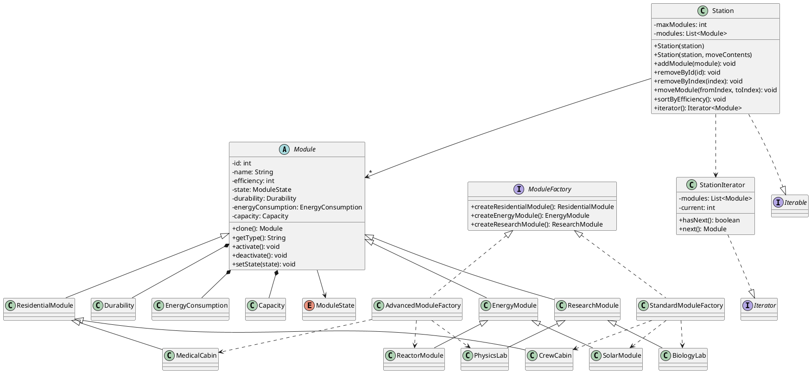

## 1. Реализованные сценарии

Демонстрация запускается методом `main` в `src/Test.java`.

1. **Создание станции и фабрики.** Создаётся станция, в неё добавляются модули, созданные `StandardModuleFactory` и `AdvancedModuleFactory`. Модули выводятся через `Iterable<Module>` и `StationIterator`.
2. **Глубокое копирование.** Создаётся копия станции через `new Station(original)`. Проверяется, что модуль в копии является отдельным объектом, его конкретный тип сохраняется, а изменение количества модулей копии не влияет на оригинал.
3. **Перемещение станции.** Конструктор `new Station(source, true)` переносит ссылки на модули без клонирования и очищает исходную станцию. Поскольку Java не имеет специального конструктора перемещения как C++, этот конструктор с флагом явно задаёт режим переноса.
4. **Операции с модулями.** Проверяются итерация, `activate()`, `deactivate()`, установка состояния `REPAIR`, перемещение модуля между индексами и сортировка по эффективности.
5. **Удаление и вместимость.** Проверяются `removeById`, `removeByIndex` и запрет добавления сверх максимальной вместимости.

Дополнительно проверяются валидация отрицательной вместимости и энергопотребления, уменьшение и восстановление прочности, а также запрет превышения максимальной прочности.

## 2. UML-диаграмма классов



## 3. Паттерны

### Абстрактная фабрика (Abstract Factory)

`ModuleFactory` объявляет методы создания трёх категорий модулей. `StandardModuleFactory` и `AdvancedModuleFactory` реализуют эти методы, создавая разные конкретные классы. Код, использующий фабрику, может создавать набор модулей, не привязываясь к конкретным классам.

### Итератор (Iterator)

`StationIterator` реализует `Iterator<Module>` и последовательно возвращает элементы станции. `Station` реализует `Iterable<Module>`, поэтому поддерживаются как явный обход через `getIterator()`, так и цикл `for-each`.

## 4. Результаты сценариев

Команда компиляции:

```bash
javac -d out $(find src -name "*.java")
java -cp out Test
```

Выполненные проверки выводят сообщения `true`. Проверены создание модулей обеими фабриками, итерация, независимость глубокой копии, сохранение типа конкретного модуля, перенос без клонирования, очистка источника, изменение состояния, перемещение и сортировка модулей, удаление по ID и индексу, ограничение вместимости и валидация атрибутов.

## 5. Вывод

В ходе этапа проект интегрирован в единый демонстрационный запуск. Реализованы сценарии создания, копирования и переноса станции, операции с модулями и проверки ограничений. Паттерны Abstract Factory и Iterator используются в рабочих классах проекта. Проверки подтверждают ожидаемое поведение реализованных сценариев.
