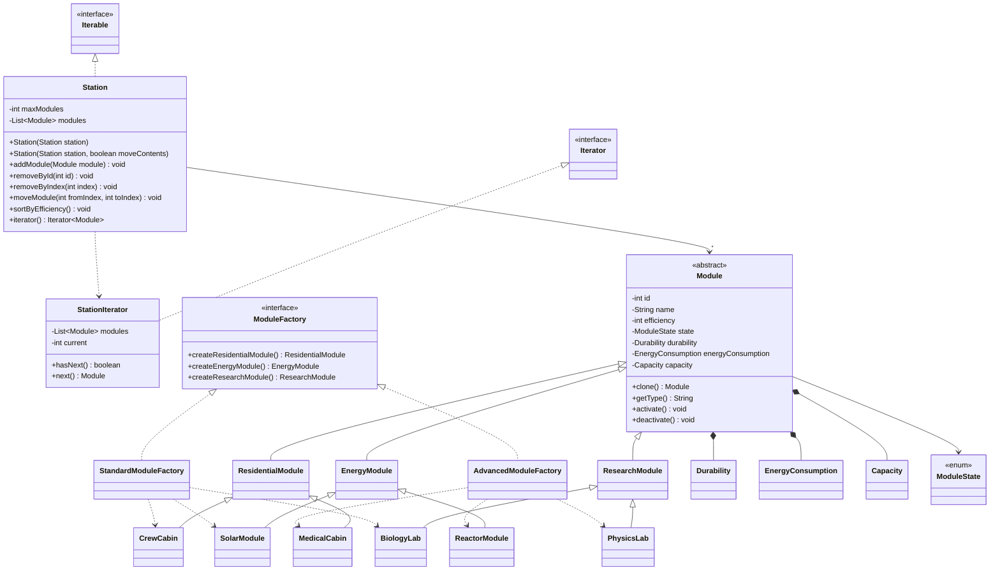

# Лабораторная работа №1. Введение в ООП: создание классов, конструкторов классов, методов классов; наследование

Проект представляет собой программную модель космической/технической станции (**Station**), состоящей из различных функциональных модулей. Архитектура разработана с соблюдением принципов SOLID, стандартов управления памятью и паттернов проектирования на языке Java.

## 🚀 Выполнение технических требований

### 1. Класс Station
*   **Создание с ограничением:** Конструктор станции принимает `maxModules` и жестко контролирует лимиты. При попытке превысить вместимость добавление блокируется.
*   **Добавление/Удаление:** Реализованы методы `addModule(Module)`, `removeById(int)` и `removeByIndex(int)` для безопасного управления составом.
*   **Глубокое копирование:** Реализован конструктор копирования `new Station(original)`, выполняющий клонирование каждого модуля через `module.clone()`. Изменения в копии никак не влияют на оригинал.
*   **Перемещение (Аналог):** Так как в Java нет нативной семантики перемещения (как в C++), реализован конструктор `new Station(source, true)`. Он переносит ссылки на модули без клонирования и гарантированно очищает исходную станцию.
*   **Итерация:** Класс предоставляет последовательный доступ к модулям.

### 2. Иерархия модулей: 3 типа × 2 реализации
Спроектирован базовый абстрактный класс `Module`, от которого наследуются 3 ветки, каждая из которых имеет по 2 конкретные реализации:
*   **Жилые модули (`ResidentialModule`):** `CrewCabin` (Жилой отсек) и `MedicalCabin` (Медотсек).
*   **Энергетические модули (`EnergyModule`):** `SolarModule` (Солнечная панель) и `ReactorModule` (Реактор).
*   **Исследовательские модули (`ResearchModule`):** `BiologyLab` (Био-лаборатория) и `PhysicsLab` (Физ-лаборатория).

### 3. Модульная структура кода
Исходный код строго разделен на логические файлы в соответствии с конвенциями Java (один публичный класс/интерфейс — один файл) и разнесен по пакетам: `module.fabric`, `module.moduleData`, `module.types`, `station`.

### 4. Механизмы копирования и перемещения
Все владеющие и составные классы поддерживают безопасное управление ресурсами:
*   В иерархии `Module` переопределен метод `clone()` для создания точных обособленных копий объектов с сохранением их конкретных типов данных.
*   Для `Station` реализованы явные режимы глубокого копирования и перемещения (очистки источника).

### 5. Выделенные классы для атрибутов
Характеристики модулей инкапсулированы в отдельные Value Object классы. Внутри них реализована бизнес-логика и валидация (запрет отрицательных значений, контроль износа):
*   `Durability` — прочность, износ модуля и ремонт.
*   `EnergyConsumption` — энергопотребление / генерация.
*   `Capacity` — вместимость модуля.

### 6. Паттерн «Абстрактная фабрика»
Интерфейс `ModuleFactory` объявляет методы создания трех типов модулей. Реализованы две конкретные фабрики, поставляющие разные наборы оборудования:
*   `StandardModuleFactory` — создает `CrewCabin`, `SolarModule`, `BiologyLab`.
*   `AdvancedModuleFactory` — создает `MedicalCabin`, `ReactorModule`, `PhysicsLab`.

### 7. Собственный итератор
Реализован собственный класс `StationIterator`, который имплементирует стандартный интерфейс `java.util.Iterator<Module>`. Класс `Station` в свою очередь реализует `Iterable<Module>`, что позволяет прозрачно использовать обход коллекции через цикл **for-each**.

---

## 📐 Архитектура проекта (UML-диаграмма классов)



---

## 📂 Структура каталогов

```text
├── src/
│   ├── module/
│   │   ├── fabric/              # Абстрактная фабрика модулей (ModuleFactory, Standard..., Advanced...)
│   │   ├── moduleData/          # Классы-атрибуты (Capacity, Durability, EnergyConsumption)
│   │   ├── types/               # Иерархия модулей (3 типа × 2 реализации)
│   │   │   ├── energyRelated/   
│   │   │   ├── research/        
│   │   │   └── residential/     
│   │   ├── Module.java          # Базовый абстрактный класс модуля
│   │   └── ModuleState.java     # Перечисление состояний модуля (enum)
│   ├── station/
│   │   ├── Station.java         # Класс управления станцией, глубокое копирование и "перемещение"
│   │   └── StationIterator.java # Собственная реализация Iterator<Module>
│   └── Test.java                # Демонстрационный запуск и проверка тест-кейсов
├── Architecture.md              # Подробное описание архитектуры
└── .gitignore
```

---

## 🛠️ Сборка и запуск

Все демонстрационные сценарии запускаются через метод `main` в файле `src/Test.java`. Тесты проверяют корректность работы фабрик, глубокого копирования, переноса данных, итерации, сортировки и валидации атрибутов. В случае успеха каждая проверка выводит `true`.

### Компиляция проекта:
```bash
javac -d out \$(find src -name "*.java")
```

### Запуск демонстрации:
```bash
java -cp out Test
```
